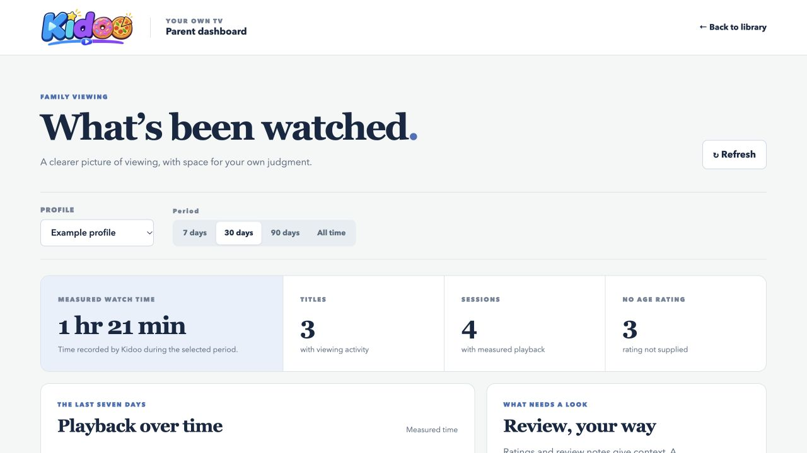
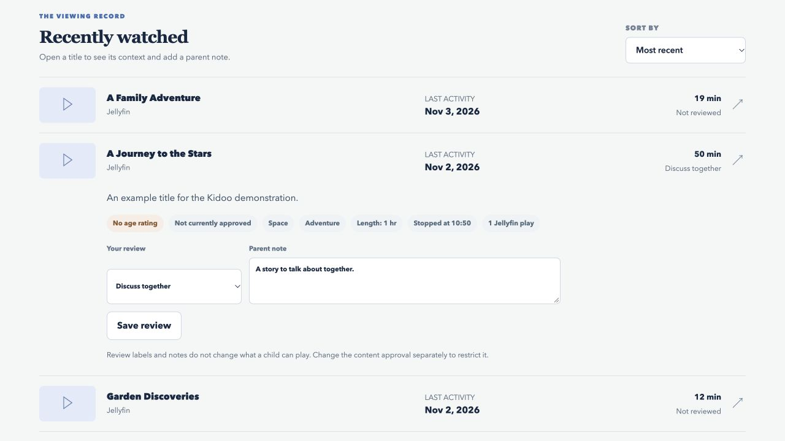
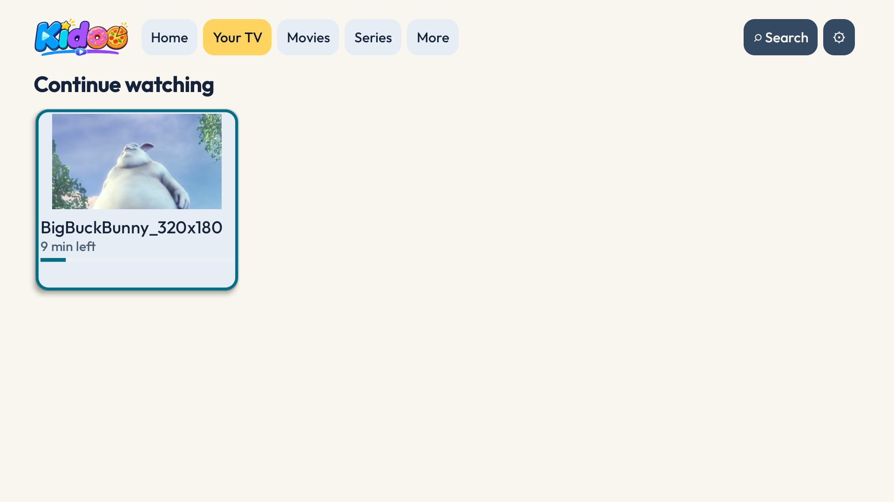
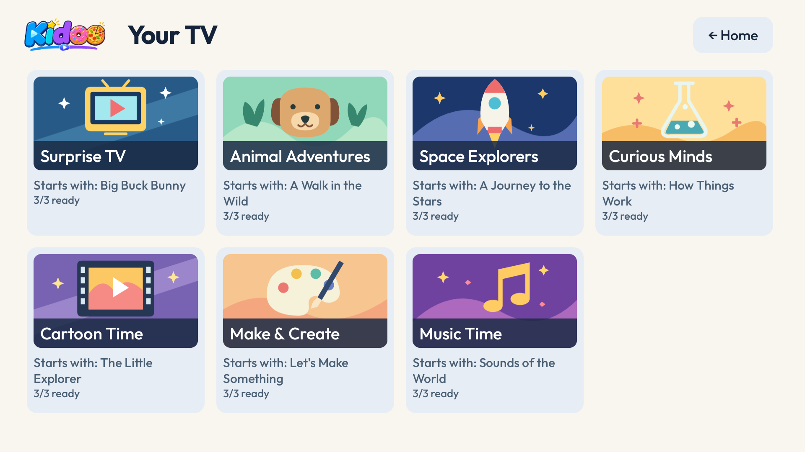

# Kidoo, TV made for your kids


**A safer place for children to watch videos, chosen by their parents.**

Parents cannot always sit beside their children or know what an algorithm will suggest next. Even a service designed for children, such as YouTube Kids, cannot guarantee that every video it offers will be right for every family. One way for parents to stay in control is to choose the content themselves before their children watch it.

Kidoo Community is designed to make that practical. It brings family videos, movies and series together in a simple TV app, including video files a family has obtained from its own DVDs or Blu-rays where permitted. Parents decide what is available; children can explore those choices and receive suggestions within the approved collection. This Community checkout does not include YouTube integration.

<table>
  <tr>
    <td></td>
    <td></td>
  </tr>
  <tr><td align="center">Viewing overview</td><td align="center">Activity and parent notes</td></tr>
  <tr>
    <td></td>
    <td></td>
  </tr>
  <tr><td align="center">TV home</td><td align="center">Your TV channel</td></tr>
</table>

[Setup and operations](docs/SETUP.md)

The dashboard screenshots use fictional titles and viewing records. The TV screenshots were captured from an isolated test app. The Your TV grid uses fictional example programme names and readiness indicators for illustration. The home screen includes *Big Buck Bunny*; © 2008 Blender Foundation / [bigbuckbunny.org](https://peach.blender.org/about/), [CC BY 3.0](https://creativecommons.org/licenses/by/3.0/). No video files or family data are included. A TV walkthrough will be added when suitable footage is available.

## The idea

Children should be able to explore and enjoy videos without parents having to trust an open-ended recommendation feed or supervise every choice. Kidoo helps families build a collection they have chosen in advance, with different approvals for each child. Its parent dashboard shows the viewing activity Kidoo can observe, alongside available context and notes, so parents can revisit their choices.

Families can add videos they have the right to use, including copies of their own discs where permitted, or connect a Jellyfin library. Kidoo does not decide whether content is appropriate: parents decide which titles to approve and can change those choices later.

**Kidoo is an early-stage, self-hosted project.** Community has been tested with isolated databases and real local and Jellyfin playback, including a Fire TV check with a separate test app. More devices, codecs and failure scenarios need testing. Review the [security and playback boundaries](#security-and-current-limitations) before relying on it for a child.

## Kidoo Community

Kidoo Community is the family-focused edition of Kidoo: a self-hosted server, a parent dashboard and a native TV app that work together with your own video files or an optional Jellyfin library. It is designed for families who want to choose what their children can watch and keep their viewing information on their own server.

Community includes profile-specific approvals, protected parent controls, viewing limits, recommendations within the approved collection and **Your TV** channels. Its source code is available in this repository so people can inspect it and help improve it. Community does not include YouTube integration; licensing details are described below.

## For children

- **A TV-first library.** Navigate with a remote through separate Movies, Series and More videos sections. Series are grouped so episodes aren’t scattered through the library.
- **Your TV.** Choose a topic channel that plays a sequence of approved videos. A preview shows what is coming next; parents can create or adjust channels for each profile. These are personal playlists, not synchronized live broadcasts.
- **Artwork that helps with choices.** Browse movie covers and series artwork where available.
- **Continue watching.** Find unfinished titles together in one row and resume from the saved position, including across compatible devices.
- **Playback controls.** See elapsed and total time while watching, and add or remove a favourite directly from the player. Known video lengths also appear when browsing.
- **Search and explore.** Search available movies, series and videos from the home screen.
- **A selection made for the profile.** Parent approvals shape what appears.

## For parents

- **Choose what is available.** Review local and Jellyfin titles, approve content for a profile, choose “Show less”, or remove access.
- **Understand viewing.** The parent dashboard shows the activity Kidoo can observe, available descriptions, topics and ratings, and space for review notes. Time watched is a clue for conversation, not proof that a video is suitable or enjoyed.
- **Set daily viewing limits.** Choose an overall limit and optional limits for Movies, Series and Other videos, per profile. Both the overall and category limit apply. Blank means unlimited; zero blocks that category. Limits reset at midnight in the server’s local time.
- **Show less without blocking.** Keep a title or series available in search while reducing its promotion in recommendations.
- **Keep control of the server.** Family settings and viewing data are stored on the Kidoo server. Protected mode adds parent PIN access, per-profile approvals and revocable TV pairing.

Kidoo records playback through supported versions of its TV app and browser. Time spent paused or seeking is excluded. Limits are approximate and cannot control playback in separate apps; see [security and current limitations](#security-and-current-limitations).

## Recommendations

Suggestions use parent-entered local topics, eligible Jellyfin genres, profile preferences and measured viewing activity within the approved collection. Started or completed titles are generally hidden from suggestions, with an exception for favourites; unfinished titles remain available in Continue watching. Parents can use **Show less** to reduce promotion without blocking access. Recommendations depend on available metadata and are not safety ratings.

## Your TV

**Your TV** turns the family's approved collection into topic channels, such as Animals, Space and Make & Create. A child chooses a channel from a grid with topic artwork and Kidoo plays one eligible video after another. The player shows the current title and an up-next preview; a video can change if it becomes unavailable or loses approval. These are personal playlists that start when selected, not scheduled broadcasts shared across devices.

Parents can create, rename, hide and configure channels for each profile using topics, languages and content sources. A channel never grants approval: profile restrictions, **Show less** choices and viewing limits continue to apply. Kidoo uses viewing activity as a modest signal, mixes familiar interests with discovery, and varies its choices where the library allows. Small collections can repeat.

Each channel keeps up to three eligible videos in a persistent playlist, replaces a completed item, and preserves the playlist across restarts. At the start of a new playlist Kidoo prefers shorter regular videos when their duration is known; unknown duration is not guessed.

Continue watching shows the most recent unfinished video from a channel, not the channel itself. Unfinished videos resume from their saved position; finished videos can be played again. Jellyfin remains the source of truth for Jellyfin playback progress. Channel definitions and viewing data stay on the family's server.

## Kidoo and Jellyfin

[Jellyfin](https://jellyfin.org/) is a general-purpose media server and client ecosystem. Kidoo adds a child-focused interface and a family curation layer; it can connect to Jellyfin but does not replace it.

| | Jellyfin | Kidoo |
| --- | --- | --- |
| Library | Organises and streams a media collection. | Brings selected Jellyfin titles and local videos into one child-oriented TV experience. |
| Family access | Provides users, library permissions and parental controls. | Adds profile-specific approvals in protected mode, a review workflow and suggestions within the chosen collection. |
| Watching | Tracks each Jellyfin user’s playback and resume position. | Uses Jellyfin’s position for Jellyfin titles and stores Kidoo-hosted local progress on the Kidoo server. |
| Parent view | Provides media and account management. | Adds a viewing dashboard with available context, notes and Kidoo playback limits. |

**Jellyfin is optional, with limitations.** Kidoo can scan and stream videos from a local folder, let parents approve them, and save viewing progress and resume positions on the Kidoo server. To provide artwork, put a `.jpg`, `.jpeg` or `.png` file beside the video with the same filename.

Without Jellyfin, parents can organize local files from the dashboard: choose whether a video is a movie, series episode or other video, and add a title, description, episode numbers and topics. Episodes with the same series name are grouped together. These details apply to all profiles; approvals remain separate. Kidoo does not fetch metadata or covers automatically. Videos without a chosen type appear under **More videos**.

Topic tags can help Your TV match local videos to channels and help Kidoo recommend local videos. Local playback also depends on the TV supporting the file’s format; Kidoo does not provide Jellyfin’s transcoding fallback for these files.

If you connect Jellyfin, use a separate Jellyfin user per Kidoo profile when children need separate Jellyfin viewing histories, and restrict each user’s Jellyfin library access appropriately.

The protected parent dashboard also offers an optional per-profile Jellyfin rating filter. Manual approval remains the default. Parents can preview matches, keep them as suggestions for manual review, or choose automatic access for titles within a selected rating limit. Kidoo requires a recognizable external identifier and a rating it understands; unknown titles, ratings and unsupported video types need parent review. Parent allow and block choices override the automatic decision, including a block for a whole series. Episode fallback to the series rating is optional.

The preview groups unresolved titles into a review queue with available artwork, descriptions, ratings and reasons. Parents can switch between the queue, suitable titles and titles above the limit, set a choice for an entire series or an individual episode, and open Jellyfin to correct a mistaken match or rating before refreshing the preview. Parent allow and block choices take effect immediately; saving the proposed rating policy is a separate action.

The filter supports selected [US movie ratings](https://www.filmratings.com/ratings-guide/), [UK BBFC ratings](https://www.bbfc.co.uk/our-age-ratings), and Italian and French rating labels used by Jellyfin. Unknown labels remain in review. It does not translate ratings between countries. Select the system that actually matches your Jellyfin metadata, because a bare rating such as `PG` does not reliably identify its country. Ratings and external IDs can be missing, incorrect or manually edited, and an age rating is not a guarantee that content is suitable. Jellyfin metadata is cached briefly (up to 30 seconds) for playback decisions; automatic decisions require a working Jellyfin connection when that cache expires. Review the preview and override titles as needed.

The rating filter has been tested against an isolated Jellyfin 12.4 library, including a real movie and series episode, as well as automated metadata and authorization tests. The protected browser flow has also been checked with a real browser and a trusted HTTPS certificate. Test your own metadata and playback before relying on automatic decisions.

Jellyfin controls when it saves resume positions. Its default minimum duration is five minutes, so shorter episodes may not appear in Continue watching even when Kidoo reports progress. The parent can adjust Jellyfin's resume settings if they want to resume shorter videos; Jellyfin's percentage thresholds also apply.

## Getting started

You need Python 3.9 or newer and a folder of videos you have permission to use. Download the repository, open a terminal in the Kidoo folder, and start the guided setup:

**macOS or Linux:**

```sh
sh setup.sh
```

**Windows:** open Command Prompt in the Kidoo folder and run `setup.cmd`. The Windows flow currently offers a local preview only and has not yet been tested on a Windows device.

The wizard offers two paths:

- **Local preview:** Try Kidoo in a browser on the same computer. Preview profiles and viewing history are temporary. This option cannot pair a TV and is not a child-safety boundary.
- **Protected home setup:** On macOS or Linux, choose a video folder, name a child profile, create a parent administrator and PIN, and optionally connect Jellyfin. You need an HTTPS certificate and key trusted by the TV and browser, and a reachable hostname covered by the certificate. The wizard can use existing files or, with your consent, request a Tailscale certificate. It can also enable automatic startup for the current user; certificate renewal and device trust still need arranging. Protected setup on Windows is not yet supported.

The wizard creates a start script for protected setup and will not overwrite an existing Kidoo database. Once signed in, the parent dashboard shows a profile-specific checklist for adding videos, approving them and pairing a child device.

After starting the server, check a connection from a computer with Python:

```sh
python3 server/connection_check.py https://YOUR_CERTIFICATE_HOSTNAME:8765
```

The check verifies the certificate and hostname, identifies Kidoo and confirms protected mode. To test a private route when DNS points elsewhere, add `--connect-ip PRIVATE_IP`; the original hostname is still used for TLS verification. This only checks the computer running the command, using Python's certificate trust store. Each TV or browser must independently trust the certificate and reach the server. Follow the [setup and operations guide](docs/SETUP.md) for platform steps, certificates, pairing, backups and recovery.

### Watching on a Mac or Windows PC

Kidoo can run on a Mac and open in a web browser; no Android device is required. Windows users can try the local browser preview, but protected setup has not yet been tested on Windows. There is no native macOS or Windows app yet.

Protected browser child mode has been tested in a real browser with an isolated Jellyfin library. Use a trusted HTTPS connection to the protected server, create a pairing code in the parent dashboard, and open `/child` in the child's browser. The browser is paired to one profile and is designed to play approved local and Jellyfin videos. Jellyfin playback requires a compatible video and audio format; browser transcoding is not provided. A parent can unlock controls with the PIN and lock them again; opening child mode also locks them. Pairing signs out an existing parent session in that browser. Devices can be revoked from the parent dashboard.

The local preview and the older Family view are not secure child modes. A browser cannot prevent a child from leaving Kidoo or opening other websites; use device-level restrictions as needed. Parent unlocks are shared across tabs of the same browser and expire server-side after five minutes, so lock controls before handing the device back. Browser progress is reported during playback; an abrupt disconnect or shutdown may lose the latest update.

### Android TV and Fire TV

The native client in [`android-tv/`](android-tv/) is designed for Android TV and Android-based Fire TV devices. Download the signed [Kidoo Community TV 0.3.0 APK](https://github.com/vitopod/kidoo/releases/tag/v0.3.0) and follow the [Fire TV installation guide](docs/FIRE-TV-INSTALL.md). It explains ADB installation, checksum verification and pairing; Android Studio is not required. The Community app has a separate package ID from Kidoo Plus. This APK has been installed and paired on a physical Fire TV against an isolated server, where local video playback and saving a position were verified. Resuming that position was not tested in this check.

To build it yourself, use Java 17, Android SDK 36 and the included Gradle wrapper:

```sh
cd android-tv
./gradlew assembleDebug
```

The debug APK is written under `android-tv/app/build/outputs/apk/debug/`. Pair the TV with your protected Kidoo server as described in the [setup guide](docs/SETUP.md#protected-mode-under-active-development). Update the server and TV app together when enabling viewing limits. This client is for Android-based devices, not Vega OS.

### Need help installing?

If you use Claude Code or Codex, you can adapt and paste this prompt:

> Help me install Kidoo Community from https://github.com/vitopod/kidoo. First inspect its README and setup guide, identify my operating system and whether I already have a Kidoo installation, and explain the protected setup and HTTPS requirements. Guide me through choosing a video folder, optionally connecting Jellyfin, reviewing content and pairing my browser or Android-based Fire TV. Preserve existing installations and data; do not expose my server to the internet, disable certificate verification, or publish personal information. Ask me to enter passwords and PINs privately rather than sharing them in chat. If a step requires my action or the device is unavailable, explain exactly what I need to do. Use the official versioned APK and verify its checksum when installing the TV app.

### Connect Jellyfin

Connect a Kidoo profile to an existing Jellyfin user from the server computer:

```sh
python3 server/jellyfin.py --profile family --server http://JELLYFIN_HOST:8096 --username JELLYFIN_USER
```

The command prompts for the Jellyfin password and stores an access token in Kidoo’s private data directory. See the [Jellyfin setup](docs/SETUP.md#jellyfin-integration) for profile mapping, permissions, playback and resume details.

## Community transition

This checkout is being separated from an earlier edition. Its YouTube catalogue, channel import, downloads and playback routes have been removed; the owner's existing installation remains a separate Kidoo Plus starting point. An offline migration can convert a supported earlier database after the service is stopped, preserving a separate backup. Read the [migration and recovery instructions](docs/SETUP.md#offline-community-migration) before using it. See the [implementation plan](docs/COMMUNITY-IMPLEMENTATION-PLAN.md) for remaining verification and release work.

## Security and current limitations

- **Use protected mode for the parent–child boundary.** It requires HTTPS trusted by the TV, a parent administrator and PIN, and a paired device. It enforces profile approvals on server requests. The legacy shared-password/HTTP mode is for trusted evaluation and is not a secure child restriction. Do not expose it to the internet.
- **Kidoo controls Kidoo.** It cannot stop a child leaving the app or opening YouTube, Jellyfin or another app. Configure device-level restrictions separately. Buffered video cannot be recalled immediately after access is revoked.
- **Viewing records are partial.** Kidoo cannot measure viewing in other apps, and older Jellyfin entries may lack measured watch time. Review labels and notes do not themselves block content.
- **Limits are approximate.** They depend on player reports and a working connection. With an active limit, updated players pause when they cannot verify the allowance. Older unclassified Jellyfin activity counts conservatively against local categories until midnight.
- **Availability varies.** Formats, codecs, network access and Jellyfin transcoding affect playback. Parent approval does not guarantee a video can be played.
- **Backups matter.** Kidoo’s database and configuration contain family data and may contain credentials. Keep backups private; the Kidoo backup tool does not include media files or Jellyfin’s own database.

See [setup and operations](docs/SETUP.md) for protected-mode setup, recovery, backups, certificate renewal and detailed Jellyfin behaviour.

## Development

```sh
python3 -m unittest discover -s tests -v
cd android-tv && ./gradlew testDebugUnitTest assembleDebug
```

To recreate the parent dashboard with isolated demonstration data, run `python3 docs/demo_dashboard.py` and open the localhost address it prints. The example data is regenerated in a temporary directory, contains no video files and never reads or changes your family’s Kidoo database. Stop the demo with Ctrl+C.

The server tests include local integration tests and need permission to bind local ports. The Android build also needs Java 17 and the Android SDK. See the [native TV plan](docs/NATIVE-TV-PLAN.md) and [device test notes](docs/NATIVE-TV-TESTS.md) for more context.

The real-media smoke test is optional. To run it, provide a rights-cleared local video and FFmpeg: `KIDOO_TEST_MEDIA=/path/to/your/video.mp4 python3 -m unittest discover -s tests -p 'test_real_playback.py'`. The test uses temporary database state and does not alter the video.

The optional Jellyfin integration test requires a **disposable loopback-only Jellyfin instance** and a rights-cleared test item. It changes that item's viewing position, so never point it at a household library. Set `KIDOO_TEST_DISPOSABLE_JELLYFIN=1`, `KIDOO_TEST_JELLYFIN_CONFIG` to a private JSON connection file, and `KIDOO_TEST_JELLYFIN_ITEM` to the test item's ID before running `python3 -m unittest discover -s tests -p 'test_real_jellyfin.py'`. Keep connection files and tokens out of the repository.

- [`server/`](server/) — Python server, parent dashboard and browser interface.
- [`android-tv/`](android-tv/) — native Kotlin TV client.
- [`tests/`](tests/) — Community server, security and playback tests.

## Licensing and commercial use

Kidoo Community is free for personal, non-commercial household use under the [Kidoo Community Licence](LICENSE). Families may modify it and share copies without charge, subject to the licence terms.

Selling Kidoo, paid hosting, commercial bundles, paid installation or support, and organisational use require the owner’s prior written permission. These restrictions make Kidoo **source-available**, rather than open source. Contact the repository owner through GitHub to request permission.

Third-party videos, artwork, fonts and trademarks have their own rights and licences; see the [third-party review](docs/THIRD-PARTY-REVIEW.md) and [Android notices](android-tv/app/src/main/assets/licenses/THIRD-PARTY-NOTICES.txt). The questions below are a practical summary; the [licence](LICENSE) contains the complete terms.

### Licensing FAQ

- **Can my family use Kidoo at home for free?** Yes. Individuals can install, run and modify it for their own household's private, non-commercial use.
- **Can a friend help me set it up?** Yes, if they are an unpaid individual helping with your household's permitted use. Paid installation or support requires the owner's prior written permission.
- **Can I share a copy or my changes?** Individuals may share source or compiled copies with other individuals without charging or receiving compensation for distribution. Include the licence and applicable notices, identify modifications, and follow the other terms in the licence.
- **Can I sell it, bundle it with a device, or offer paid hosting?** These uses require the owner's prior written permission or a separate agreement. Charging for distribution also requires permission.
- **Can a school, charity or business use it?** Organisational use requires the owner's prior written permission, even if the organisation does not charge its users.
- **Is Kidoo open source?** Its code is available to inspect, but its commercial and organisational restrictions mean it is source-available rather than open source.
- **Can I contribute?** Contributions are welcome for consideration. A [draft contributor agreement](docs/CONTRIBUTOR-AGREEMENT-DRAFT.md) is being prepared for review; it is not in effect, and submitting a pull request does not mean you have agreed to it. The owner may request an agreement before accepting a contribution.

### Request permission

Contact the [repository owner through GitHub](https://github.com/vitopod) before a use that needs permission. Describe your organisation or role, what you want to do, whether and how you will charge, and whether you plan to distribute Kidoo, include it in a product, host it, or provide installation or support. The owner can then discuss a separate agreement or written permission with you.

GitHub issues and other public posts are visible to everyone: do not include passwords, family information, or confidential business details. A request does not itself grant permission.
